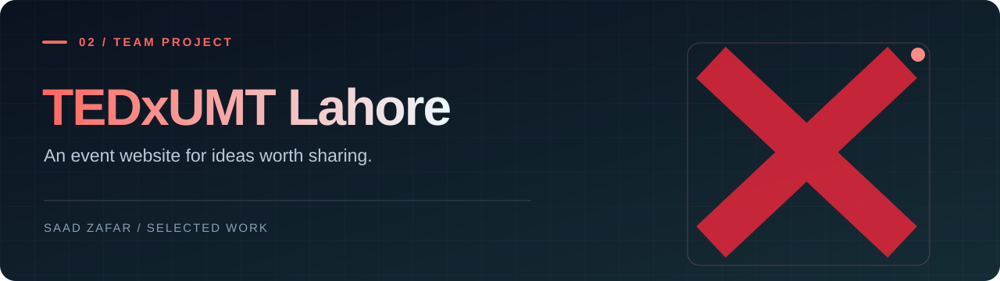
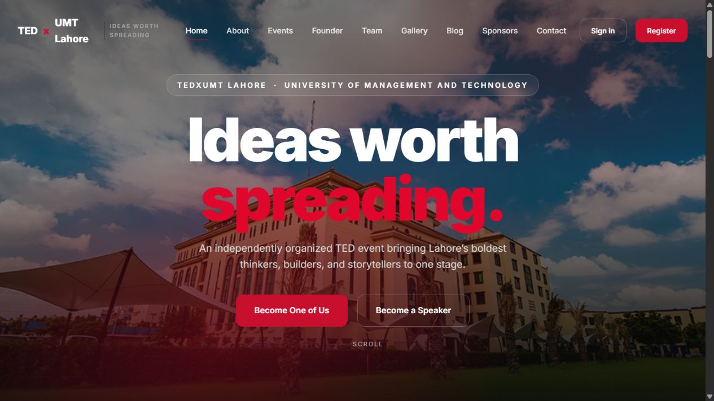
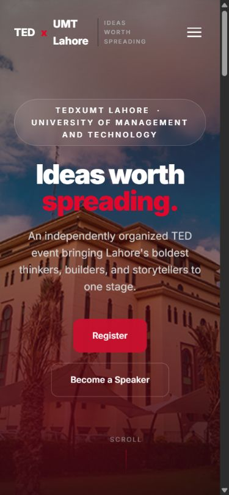

  

<b><a href="https://tedxumtlahore.vercel.app/">Visit the live website ↗</a></b> · <a href="https://github.com/Saad-Zafar1">Back to my portfolio</a>

## A digital home for an event community

The **TEDxUMT Lahore website** brings event information and the organization’s public presence together, helping visitors explore the event, discover the team, and find ways to participate.

## My role & the team

**Saad Zafar — IT Lead and development team member.**

I served as IT Lead and worked alongside **two other team members** to build this website. Development was a collaborative effort shared across our three-person team.

Credit for the website belongs to the development team collectively. My role here represents my leadership and contribution to that shared work.

## Inside the experience

| Area | What visitors can explore |
| --- | --- |
| Event identity | A branded homepage introducing TEDxUMT Lahore. |
| Organization | About, founder, and team pages. |
| Event content | Events, gallery, blog, and sponsor entry points. |
| Participation | Registration and speaker application entry points. |
| Contact | Ways to reach the event organization. |

## On a smaller screen

## Explore it yourself

- **[Open TEDxUMT Lahore](https://tedxumtlahore.vercel.app/)**
- **[Meet the event team](https://tedxumtlahore.vercel.app/team)**
- **[See my solo project: PyaraSaGhar](https://github.com/Saad-Zafar1/pyarasaghar-showcase)**

---

This is a personal portfolio showcase of a team-built website, containing presentation assets and documentation. Website application source code and private configuration are not included. TED and TEDx branding belongs to its respective owners. Screenshots show the public website as captured on 17 November 2026; the live site may change.
